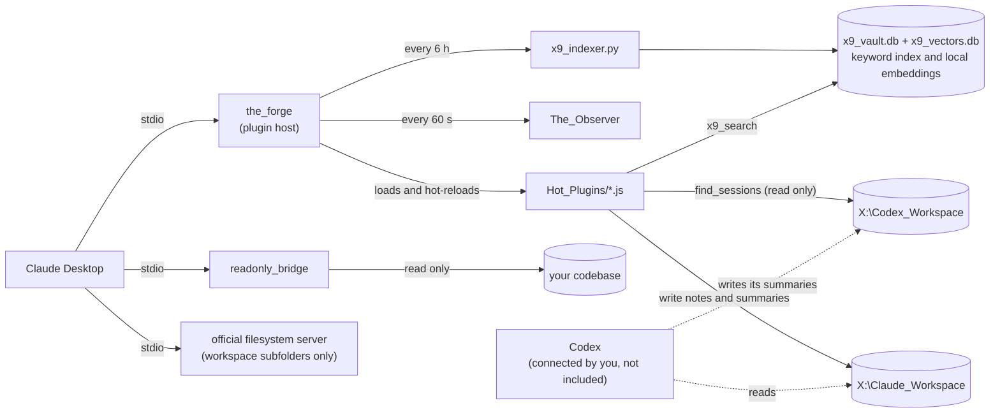

# Shared AI Workspace MCP: a persistent workspace for Claude on an external drive

[](https://github.com/bman-1018/shared-ai-workspace-mcp/actions/workflows/ci.yml)
[](LICENSE)


Every new chat starts from zero, and notes, plans and decisions end up scattered across chat histories you cannot search. This repo puts a workspace on an external SSD and gives Claude Desktop tools to read it, write to it, search it, and save its own chat history back into it. Because the workspace is just folders and text files, any other tool that can open a folder (Codex, an editor, another chat app) can use the same files.

It is meant for Windows users. You edit one config file, restart Claude Desktop, and the tools appear.

What it is not: it does not connect web-based clients (ChatGPT, Codex in ChatGPT, claude.ai) because they run on their makers' servers and need a public HTTPS address this project does not provide, and it does not connect Codex for you (see [Codex access](docs/CONFIGURATION.md#codex-access)). Not affiliated with or endorsed by Anthropic or OpenAI. Claude, ChatGPT and Codex are trademarks of their owners.

## What is in the box

| Folder | What it does |
|---|---|
| `the_forge` | The main MCP server. It loads small plugins from `Hot_Plugins` and reloads them when you change them, with no Claude restart. It also logs each tool call, with long values cut and secret-looking values hidden. |
| `Hot_Plugins` | The plugins: `panoptic_push` (save big files in chunks), `submit_code_plan` (write a plan file before coding), `save_session_summary` and `find_sessions` (written summaries of conversations, shared with Codex), `x9_search` (keyword and optional semantic search), `x9_workspace_mapper` (folder tree), and `hello_forge` (a test tool). |
| `readonly_bridge` | A second MCP server that can only read one codebase folder and run `git status`, `diff`, `log -n 5` and `branch`. |
| `The_Observer` | Scripts that copy the chat log (`audit.jsonl`) of your Claude Desktop agent-mode (Cowork) sessions to the drive and turn it into readable markdown. They do not capture regular Claude chats or ChatGPT. |
| `x9_search_engine` | The Python indexer and query script behind `x9_search`: keyword search, plus optional semantic (meaning-based) search that runs entirely on your PC. |

## How it works



Each server gets only the permissions it needs: the Forge writes notes but not into folders that hold code, the read-only bridge has no write tools at all, and the official filesystem server is limited to workspace subfolders. The dotted lines are Codex's side, which you set up yourself.

## Quick start

**You need:** Windows 10 or 11, an external drive you can assign to **X:**, [Node.js](https://nodejs.org) 22+ (24 recommended), and optionally [Python](https://www.python.org) 3.10+ on PATH (search) and [Git](https://git-scm.com) (bridge git tools).

1. **Prepare the drive.** Set the letter to **X** in Disk Management (**Win + X** → *Disk Management* → right-click the partition → *Change Drive Letter and Paths*). Copy [`workspace_template/claude`](workspace_template/README.md) into `X:\Claude_Workspace` to create the folders, and put this repo in `X:\Claude_Workspace\_mcp_tools`. The folder names inside must stay as they are; the servers find each other by relative path.
2. **Install dependencies.** In a terminal in `X:\Claude_Workspace\_mcp_tools`:

   ```
   npm run install:all
   ```

3. **Edit the config.** Open `%APPDATA%\Claude\claude_desktop_config.json` (**Win + R** → paste `%APPDATA%\Claude`) and add the servers from [`claude_desktop_config.example.json`](claude_desktop_config.example.json) to `mcpServers`. Then set `READONLY_BRIDGE_DIR` to the folder Claude may read, check the `command` paths point at your Node.js install, and double every backslash (`X:\\Claude_Workspace`). [`docs/CONFIGURATION.md`](docs/CONFIGURATION.md#editing-the-claude-desktop-config) walks through each entry and why the file server gets subfolders rather than the workspace root.
4. **Restart Claude Desktop completely.** Closing the window is not enough: right-click the tray icon → **Quit**, then reopen. **Settings, Developer** should list the servers as running.
5. **Try it.** Ask Claude "Run hello_forge." then "Map the root of my workspace." Both work on an empty drive.

Any drive letter works if you change it in every path in the config and set `X9_ROOT`. Nothing else in the code needs to change.

## Search

With Python installed the Forge builds an index about 15 seconds after it starts and rebuilds it every 6 hours, covering `.md`, `.js`, `.ts`, `.json`, `.py`, `.txt` and `.sql` in your workspace (and `X:\Codex_Workspace` if it sits next to it), while skipping secret-looking files and its own action log. Keyword search matches every word you type in any order; quote a phrase to keep it together, and each result shows the file's modified date.

**Semantic search is optional.** It finds meaning rather than words, so "how much do we charge customers" finds a note titled "Pricing tiers", and it runs entirely on your PC with [BAAI/bge-small-en-v1.5](https://huggingface.co/BAAI/bge-small-en-v1.5) (MIT, 133 MB) — your files never leave the machine. Once its packages are installed in a venv next to the search scripts, `x9_search` runs in `hybrid` mode: both searches run, the rankings are merged, and each result says whether it matched by `keyword`, `semantic` or both. Setup steps, first-build timings and the tuning knobs are in [`docs/CONFIGURATION.md`](docs/CONFIGURATION.md#semantic-search-optional).

## Session summaries: sharing context between Claude and Codex

Instead of saving whole transcripts, the Forge saves a **written summary** of each conversation: what was asked, what was done, what was decided and why, what is still open, and the files and branches involved. `save_session_summary` writes `04_Session_Notes\YYYY-MM-DD_title.md` and never overwrites an earlier one; `find_sessions` lists and searches summaries from both agents.

Codex writes the same format to `X:\Codex_Workspace\02_Outbox\session_summaries\YYYY-MM-DD_title.md` (or `03_Outbox`; see `workspace_template/codex/AGENTS.md`). Because each agent only reads the other's folder, nothing needs copying: ask Claude "what did Codex do on the billing work?" and `find_sessions` reads Codex's side, or tell Codex to read `X:\Claude_Workspace\04_Session_Notes` to see what Claude decided. Say "save a session summary" to trigger one; the server also prompts Claude at the end of a substantial session, but cannot force it.

## Adding your own tool

Drop a `.js` file into `Hot_Plugins` exporting `toolName`, `toolSchema` and `toolHandler` (see `hello_forge.js`); the Forge picks it up within seconds. Files starting with `_` are ignored, which is how `_shared.js` holds helpers. To mark a plugin read only without editing it, add `Hot_Plugins/_annotations.json`, e.g. `{"my_tool": {"readOnlyHint": true}}`; a plugin's own `annotations` win. Read the security notes first: anything in that folder runs on your computer.


## Security

Read [SECURITY.md](SECURITY.md) before you use this. The short version:

- The Forge runs every plugin in `Hot_Plugins` with your user rights. Treat that folder like your startup folder.
- Claude can write files through `panoptic_push` and the `X9_External_Drive` file server, but neither can write into `_mcp_tools` or `Claude_Plugins` by default, because the example config lists workspace subfolders instead of the root.
- The Forge logs every tool call in `07_Chat_History`. Long values are cut and secret-looking ones hidden, but that is best effort: do not point this at folders that hold secrets, and consider encrypting the drive.
- The Observer copies the log of your agent-mode sessions onto the drive in plain text.
- Local servers need no authentication, which is why no tunnel or public address is provided. Web clients are unsupported on purpose.

A security review was run by the author before release, not by an independent party: it found and fixed a path traversal in `panoptic_push`, a shell injection in the search plugin, a path-prefix bug in the bridge and vulnerable dependencies, and added the safer defaults above. Details in [SECURITY.md](SECURITY.md).

## Testing and contributing

Tests live in `tests/`; `npm test` runs the full suite, covering the path rules (including Windows path rules simulated on any OS), every plugin, the bridge, the Observer, the log filter and search. CI runs it on every pull request on Windows and Ubuntu with Node 22 and 24, plus `npm audit` and a registry signature check. The tests use temporary folders rather than Claude Desktop or a real drive, so the full setup has not been run end to end on a clean Windows machine; please report anything that behaves differently on yours.

Issues and pull requests are welcome. [CONTRIBUTING.md](CONTRIBUTING.md) covers the development setup and the rules plugins must follow, and [CHANGELOG.md](CHANGELOG.md) records what changed.

## More detail

| Document | Contents |
|---|---|
| [docs/CONFIGURATION.md](docs/CONFIGURATION.md) | Every environment variable, the full folder layout, how the index and semantic search work, permission prompts, Codex access, troubleshooting |
| [AGENT_SETUP.md](AGENT_SETUP.md) | A prompt that lets an AI coding agent do the setup for you (keep it in a mode that asks before editing) |
| [docs/ENGINEERING_NOTES.md](docs/ENGINEERING_NOTES.md) | Design trade-offs and the problems solved along the way |
| [SECURITY.md](SECURITY.md) | Threat model, what remote access would require, and the review findings |

## License

MIT. See [LICENSE](LICENSE).

