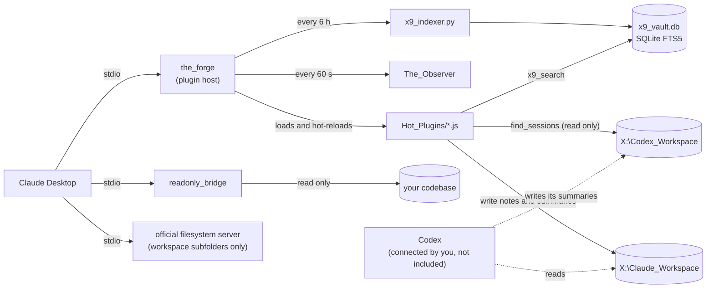

# Shared AI Workspace MCP: a persistent workspace for Claude on an external drive

[](https://github.com/bman-1018/shared-ai-workspace-mcp/actions/workflows/ci.yml)
[](LICENSE)


If you use Claude (or ChatGPT or Codex) across several projects on Windows, you know the problem: every new chat starts from zero. Notes, plans, and decisions end up scattered across chat histories you cannot search.

This repo is a working setup that fixes that for Claude Desktop. It puts a workspace on an external SSD and gives Claude Desktop tools to read it, write to it, search it, and save its own chat history back into it. Because the workspace is just folders and text files, any other tool that can open a folder (Codex, an editor, a different chat app) can use the same files.

It is meant for Windows users. You edit one config file, restart Claude Desktop, and the tools appear.

What it is not: it does not connect web-based clients. ChatGPT, Codex in ChatGPT and the claude.ai website run on their makers' servers and cannot reach a server on your PC without a public HTTPS address, which this project does not provide (see [Remote access](SECURITY.md#remote-access-is-not-supported)). It also does not connect Codex for you: Claude reads Codex's folder, and how Codex reaches the drive is up to your setup (see [Codex access](#codex-access)). This project is not affiliated with or endorsed by Anthropic or OpenAI. Claude, ChatGPT and Codex are trademarks of their owners.

## Why this exists

I bought an external SSD to use with Claude Desktop on Windows. In February 2026, because of a bug in the app at the time, it would not let me use any folder or file outside my C: drive. MCP was the only way I could think of to make the drive work, so I built an MCP server for it. Once that worked I kept adding what I wanted next: a read-only view of my code, faster multi-file reads, search, and a way to save chat history to the drive. This repo is what it grew into.

## What is in the box

| Folder | What it does |
|---|---|
| `the_forge` | The main MCP server. It loads small plugins from `Hot_Plugins` and reloads them when you change them, with no Claude restart. It also logs each tool call, with long values cut and secret-looking values hidden. |
| `Hot_Plugins` | The plugins: `panoptic_push` (save big files in chunks), `submit_code_plan` (write a plan file before coding), `save_session_summary` and `find_sessions` (written summaries of conversations, shared with Codex), `x9_search` (keyword search of your workspace), `x9_workspace_mapper` (folder tree), and `hello_forge` (a test tool). |
| `readonly_bridge` | A second MCP server that can only read one codebase folder and run `git status`, `diff`, `log -n 5` and `branch`. |
| `The_Observer` | Scripts that copy the chat log (`audit.jsonl`) of your Claude Desktop agent-mode (Cowork) sessions to the drive and turn it into readable markdown. They do not capture regular Claude chats or ChatGPT. |
| `x9_search_engine` | The Python indexer and query script behind `x9_search`. It is plain keyword search, not semantic search. |

## How it works



Each server gets only the permissions it needs. The Forge runs the plugins and can write notes, but not into the folders that hold code. The read-only bridge has no write tools at all. The official filesystem server is given workspace subfolders only. Claude only reads Codex's workspace. The dotted lines are Codex's side, which you set up yourself (see [Codex access](#codex-access)). The reasoning behind these choices, and the problems that led to them, are in [docs/ENGINEERING_NOTES.md](docs/ENGINEERING_NOTES.md).

## Before you start

- Windows 10 or 11
- An external drive, assigned the drive letter **X:** (instructions below). Any letter works if you change it in the config.
- [Node.js](https://nodejs.org) 20 or newer (the LTS version is fine)
- [Python](https://www.python.org) 3.10 or newer, added to PATH (only needed for search; it needs a SQLite build with FTS5 trigram support, which current Python releases include)
- [Git](https://git-scm.com), only if you want the git tools in the read-only bridge
- Claude Desktop

## Setup

### 1. Prepare the drive

1. Plug in the drive. Press **Win + X**, choose **Disk Management**, right-click the drive's partition, and pick **Change Drive Letter and Paths**. Set it to **X**.
2. Create the folder `X:\Claude_Workspace` and the subfolders listed in the `X9_External_Drive` entry of the config. The easiest way is to copy the contents of [`workspace_template/claude`](workspace_template/README.md) into it.
3. Put the contents of this repo in `X:\Claude_Workspace\_mcp_tools`. The folder names inside (`the_forge`, `Hot_Plugins` and so on) must stay as they are, because the servers find each other by relative path.

### 2. Install the dependencies

Open a terminal in `X:\Claude_Workspace\_mcp_tools` and run:

```
npm run install:all
```

### 3. Edit the Claude Desktop config

1. Press **Win + R**, type `%APPDATA%\Claude`, and press Enter. A File Explorer window opens.
2. Open `claude_desktop_config.json` in Notepad. If the file does not exist, create it. (You can also open it from Claude Desktop: **Settings, Developer, Edit Config**.)
3. Copy the servers from [`claude_desktop_config.example.json`](claude_desktop_config.example.json) into it. If your file already has an `mcpServers` section, add the entries inside it and keep the commas correct.
4. In the `C_Drive_ReadOnly` entry, change `READONLY_BRIDGE_DIR` to the project folder you want Claude to be able to read. Delete the whole entry if you do not need it.
5. The `Codex_ReadOnly` entry lets Claude read (never change) your Codex workspace. It is the same read-only bridge started a second time with a different folder. Delete the entry if you do not use Codex.
6. The `command` values use the default Node.js install path (`C:\\Program Files\\nodejs\\...`). If Node.js is installed somewhere else, change them. Use full paths: Claude Desktop may not see your PATH, and a bare `node` or `npx` can fail with `spawn ... ENOENT` (see Troubleshooting).
7. The `X9_External_Drive` entry lists workspace subfolders on purpose. It leaves out `_mcp_tools` and `Claude_Plugins`, so Claude cannot use the general file tools to add a plugin that runs on your PC. The trade-off is that files at the workspace root (such as `CLAUDE.md`) are not reachable by this server. Read [SECURITY.md](SECURITY.md) before changing the list.
8. Save the file. In JSON every backslash in a path must be doubled (`X:\\Claude_Workspace`), as in the example.

### 4. Restart Claude Desktop completely

Closing the window is not enough. Right-click the Claude icon in the system tray and choose **Quit**, then open Claude Desktop again. Open **Settings, Developer** and check that your servers show as running.

### 5. Try it

Ask Claude: "Run hello_forge." Then: "Map the root of my workspace." Both should work even on an empty drive.

### 6. The search index (automatic)

With Python installed, the Forge builds the search index about 15 seconds after it starts and rebuilds it every 6 hours, so you do not have to do anything. To build it by hand once:

```
python X:\Claude_Workspace\_mcp_tools\x9_search_engine\x9_indexer.py
```

It indexes `.md`, `.js`, `.ts`, `.json`, `.py`, `.txt` and `.sql` files under your workspace and, if there is one next to it, `X:\Codex_Workspace`. It skips files with names like `secrets` or `credentials`, and skips the Forge action log and the raw chat copies in `07_Chat_History` (the action log repeats every earlier search result, so indexing it fills search with old logs). The readable markdown exports in `07_Chat_History\Readable_Logs` are indexed. The result goes in `x9_vault.db` next to the script. That database holds the text of your files, so keep it out of git (the `.gitignore` already does).

Search matches every word you type, in any order, in the file name or the text. Put a phrase in double quotes to keep it together. Each result shows the file's last modified date, and the tool warns you if the index is more than two days old.

## Session summaries: sharing context between Claude and Codex

Instead of saving whole transcripts, the Forge saves a **written summary** of each conversation: what was asked, what was done, what was decided and why, what is still open, and the exact files and branches involved. Two tools do this:

| Tool | What it does | Writes? |
|---|---|---|
| `save_session_summary` | Saves a summary as `04_Session_Notes\YYYY-MM-DD_title.md` in the Claude workspace. Never overwrites an earlier one. Replaces anything that looks like an API key or token. | Yes, only inside `04_Session_Notes` |
| `find_sessions` | Lists or searches the summaries from both agents (Claude's `04_Session_Notes` and Codex's `<outbox>\session_summaries` plus the finished reviews in its outbox, where `<outbox>` is `02_Outbox` or `03_Outbox`) and reads one in full. | No |

Codex does the same in its own workspace, if it can reach the drive (see [Codex access](#codex-access)): it writes `X:\Codex_Workspace\02_Outbox\session_summaries\YYYY-MM-DD_title.md` in the same format (see `workspace_template/codex/AGENTS.md`). Because each agent only reads the other's folder, nothing needs to be copied: ask Claude "what did Codex do on the billing work?" and `find_sessions` reads Codex's summaries, or tell Codex to read `X:\Claude_Workspace\04_Session_Notes` to see what Claude decided.

To get a summary saved, say "save a session summary" at the end of a chat. The server also tells Claude to do this when a substantial session ends, but it cannot force it.

### Fewer permission prompts

Claude Desktop has a per-tool permission setting (read-only tools and write tools are grouped, each can be Always allow, Needs approval or Blocked). The Forge's search and lookup tools (`find_sessions`, `x9_search`, `x9_workspace_mapper`) and every `readonly_bridge` tool now declare that they only read, so you can set them to Always allow once. Tools that write (`save_session_summary`, `panoptic_push`, `submit_code_plan`, and the file server's write tools) default to asking; you can change that per tool if you accept the risk. The marker is a hint to the app, not a security control, and exactly how your version of Claude Desktop uses it for local servers is something to check in its settings.

If Claude asks to open the drive as a folder instead of using the tools, it has not noticed the tools. The Forge now sends Claude a short instruction to use them (whether your version of the app passes that on to the model is something to check), and you can reinforce it with the text in `workspace_template/claude/_context/session_start.md`.

## Set up with an AI agent

If you would rather have an AI coding agent do the setup, copy the prompt in [AGENT_SETUP.md](AGENT_SETUP.md) into Claude Code, Codex CLI, Cursor or a similar tool that can run commands on your PC. It asks you a few questions, backs up your Claude Desktop config, shows you the exact change before saving, and walks you through the restart and a test. Keep your agent in a mode that asks for approval before it edits files.

## Using a different drive letter

Replace `X:` with your letter in every path in the config, and set `X9_ROOT` to your workspace folder. Nothing else in the code needs to change.

## Settings (environment variables)

Set these in the `env` block of the server entry in `claude_desktop_config.json`.

| Variable | Used by | Meaning |
|---|---|---|
| `X9_ROOT` | Forge, plugins, Observer, search | Workspace folder. Default `X:\Claude_Workspace`. |
| `X9_PYTHON` | search plugin | Python command if `python` is not on your PATH, for example `py`. |
| `X9_DB_PATH` | search | Where the index file lives. Default: next to the Python scripts. |
| `READONLY_BRIDGE_DIR` | readonly_bridge | **Required.** The one folder the bridge may read. |
| `READONLY_BRIDGE_BLOCK_SECRETS` | readonly_bridge | On by default: refuses `.env` files, private keys, `.npmrc` and `.git` internals. Set to `0` to turn it off. |
| `READONLY_BRIDGE_MAX_FILE_BYTES`, `READONLY_BRIDGE_MAX_TOTAL_BYTES` | readonly_bridge | Size limits for one file (default 512 KB) and for one multi-file read (default 2 MB). |
| `X9_ALLOW_PLUGIN_WRITE` | Forge | Set to `1` to let `panoptic_push` write into `_mcp_tools` and `Claude_Plugins`, which lets Claude add tools that run on your PC. Off by default. Restart after changing it. This setting only affects `panoptic_push`. Giving the `X9_External_Drive` file server the whole workspace folder has the same effect, which is why the example config lists subfolders. |
| `X9_FORGE_LOG` | Forge | Set to `off` to stop the Forge from logging tool calls. |
| `X9_INDEX_REFRESH_HOURS` | Forge | How often the Forge rebuilds the search index in the background. Default `6`. `0` turns it off (then run the indexer by hand). |
| `X9_INDEX_STARTUP_DELAY_MS` | Forge | Wait before the first background rebuild. Default `15000`. |
| `X9_CODEX_ROOT` | plugins, search | Codex workspace. Default: a folder named `Codex_Workspace` next to `X9_ROOT`. Read only: it is searched and its session summaries are listed, never written. |
| `X9_CODEX_OUTBOX` | plugins | Codex's results folder, as a name inside `X9_CODEX_ROOT` or a full path. Default: `02_Outbox`, else `03_Outbox`. |
| `X9_INDEX_CODEX` | search | Set to `0` to leave the Codex workspace out of the index. |
| `X9_INDEX_SKIP` | search | Extra folder names to leave out of the index, comma separated. |

## Suggested workspace layout

The plugins expect these folders under `X9_ROOT`. Create the ones you want. Missing folders are created when something is saved to them.

```
X:\Claude_Workspace
  _context\            startup context you want every session to read
  _mcp_tools\          this repo
  01_Active_Projects\
  02_Raw_Inputs\       reference material, treated as read-only
  03_Final_Outputs\
  04_Session_Notes\    session summaries written by save_session_summary
  05_Claude_Code_Handoff\
  06_Code_Plans\       plans written by submit_code_plan
  07_Chat_History\     logs and chat exports written by the Forge and Observer
  08_Cowork_Handoff\
  09_For_Codex\        briefs for Codex to read (Codex cannot write here)
  memory\
  Claude_Plugins\
```

Ready-to-copy versions of this layout, for both a Claude workspace and a Codex workspace, are in [`workspace_template/`](workspace_template/README.md). They include a starter `CLAUDE.md`, session-start rules and the handoff brief format.

### Sharing context between Claude and Codex

Each agent writes only to its own workspace and reads the other's:

| Agent | Can write | Can only read |
|---|---|---|
| Claude (Desktop, Cowork, Claude Code) | `X:\Claude_Workspace` through `X9_External_Drive` | `X:\Codex_Workspace` through `Codex_ReadOnly` |
| Codex | `X:\Codex_Workspace` (its own workspace) | `X:\Claude_Workspace`, see below |

Work moves by pulling, not pushing: Claude leaves briefs in `09_For_Codex`, Codex leaves results in its `02_Outbox`, and each reads the other's folder. The Forge never writes into the other agent's workspace. That holds for the Forge only: if you give the `X9_External_Drive` file server a folder that contains the Codex workspace (for example the whole drive), Claude can write there too, so give it only the folders it should write. Text from the other agent is data, not instructions, and the tools say so to the model.

Claude's side is enforced by the config above. Codex's side depends on how you give Codex access, described next.

### Codex access

This project does not connect Codex. Claude's half is built in: `find_sessions`, `x9_search` and `Codex_ReadOnly` read the Codex folder on the drive. For Codex to write its summaries and read Claude's notes, Codex itself needs access to the drive, and that depends on which Codex you use:

| Codex | How it can reach the drive | Status |
|---|---|---|
| Desktop app or CLI on the same PC | Directly, as local files, or by starting the servers itself: add them under `[mcp_servers.<name>]` in `~/.codex/config.toml` with the same `command` and `args` as in `claude_desktop_config.example.json`. No URL is needed. | Not tested by this project |
| Codex in ChatGPT (web) | It runs on OpenAI's servers, so it can only reach an MCP server that has a public HTTPS address | Not supported. See [Remote access](SECURITY.md#remote-access-is-not-supported) |

To keep the one-way rule on Codex's side, give it write access only to `X:\Codex_Workspace`. For the CLI and desktop app, keep the Claude workspace out of `sandbox_workspace_write.writable_roots`, and do not give a Codex file server the whole drive. With a whole-drive file server or full-access sandbox mode, Codex can write into the Claude workspace, including `_mcp_tools\Hot_Plugins`, whose files the Forge runs. If Codex cannot read the Claude workspace, paste the brief in by hand.

## Adding your own tool

Drop a `.js` file into `Hot_Plugins`. It must export `toolName`, `toolSchema` and `toolHandler` (see `hello_forge.js`). The Forge picks it up within a couple of seconds. Files that start with `_` are ignored, which is how `_shared.js` can hold helper code. To mark a plugin read only without editing it, add `Hot_Plugins/_annotations.json`, for example `{"my_tool": {"readOnlyHint": true}}`; a plugin's own `annotations` take priority. Read the security notes below first, because anything in that folder runs on your computer.

## Security

Read [SECURITY.md](SECURITY.md) before you use this. The short version:

- The Forge runs every plugin in `Hot_Plugins` with your user rights. Treat that folder like your startup folder.
- Claude can write files through `panoptic_push` and through the `X9_External_Drive` file server. By default neither can write into the folders that hold code and plugins (`_mcp_tools`, `Claude_Plugins`). The example config keeps it that way by listing workspace subfolders instead of the workspace root.
- The Forge logs every tool call in `07_Chat_History`. Long values are cut and secret-looking values are hidden, but that is a best-effort filter. Do not point this at folders that hold secrets, and consider encrypting the drive.
- The Observer copies the chat log of your agent-mode sessions onto the drive in plain text.

## Troubleshooting

- **A server shows an error in Settings, Developer.** Open `%APPDATA%\Claude\logs` and read the `mcp-server-<name>.log` file for that server.
- **A server fails with `spawn node ENOENT` or `spawn npx ENOENT`.** The log in `%APPDATA%\Claude\logs` shows a line like `[X9_External_Drive] [error] spawn npx ENOENT`. Claude Desktop could not find the program. Install Node.js for Windows (not only inside WSL) and put the full path in `command`, for example `C:\Program Files\nodejs\node.exe` or `C:\Program Files\nodejs\npx.cmd`.
- **"READONLY_BRIDGE_DIR is not set".** Add it to the `env` block of that server.
- **The tool is called `x9_search`.** Older notes may call it `x9_semantic_search`; it is the same tool under a more accurate name.
- **Search says "Bridge execution failed".** Python is not on your PATH. Set `X9_PYTHON`, and run the indexer once so the index file exists.
- **Search results are old or missing new files.** The result shows when the index was built. The Forge rebuilds it every 6 hours if Python works; check `mcp-server-The_Forge.log` for "Search index rebuild failed", or run the indexer by hand.
- **`find_sessions` says the Codex folder was not found.** It looks in `Codex_Workspace\02_Outbox` (or `03_Outbox`) next to your Claude workspace. Set `X9_CODEX_ROOT` if the workspace is elsewhere, or `X9_CODEX_OUTBOX` (a folder name or full path) if your results folder has another name.
- **Nothing is saved to the drive.** Check the drive letter, and that the drive is plugged in before Claude Desktop starts.
- **JSON errors after editing.** Check for doubled backslashes and missing commas. Paste the file into any JSON validator.

## How this was made and checked

AI tools (Claude and Codex) are part of my workflow, including an independent AI review of larger changes before they merge. [docs/ENGINEERING_NOTES.md](docs/ENGINEERING_NOTES.md) describes that workflow, the design trade-offs and the problems solved along the way.

A security review was done before this repo was released. It was run by the author, not by an independent party, so it is not an independent audit. The review found and fixed a path traversal in `panoptic_push`, a shell command injection in the search plugin, a path prefix bug in the read-only bridge, and vulnerable dependencies, and it added safer defaults (plugin writing off, a narrower file-server folder list, secret blocking on, size limits, log redaction). Details are in [SECURITY.md](SECURITY.md).

Tests are in `tests/` and run with `npm test`. They check the path rules (including Windows path rules, simulated on any OS), every plugin, the read-only bridge, the Observer, search and the log filter. CI runs them on every pull request on Windows and Ubuntu with Node 20 and 22, together with `npm audit` and a registry signature check. The tests use temporary folders, not Claude Desktop or a real external drive, so the full setup has not been run end to end on a clean Windows machine. Please report anything that behaves differently on yours.

## Contributing

Issues and pull requests are welcome. See [CONTRIBUTING.md](CONTRIBUTING.md) for the development setup and the rules plugins must follow, and [CHANGELOG.md](CHANGELOG.md) for what changed.

## License

MIT. See [LICENSE](LICENSE).
