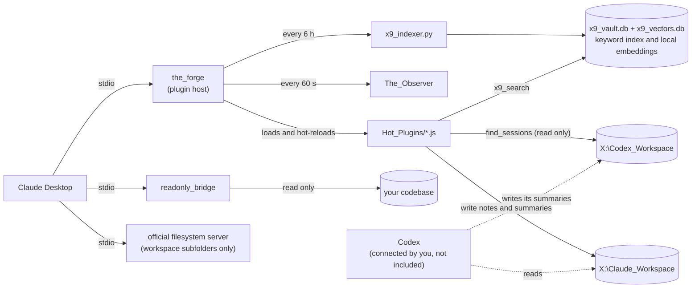

# Configuration

The [README](../README.md) quick start gets the Forge running. This page covers everything after that: adding the other servers, changing settings, and fixing problems.

- [Editing the Claude Desktop config](#editing-the-claude-desktop-config)
- [What each part does](#what-each-part-does)
- [Settings (environment variables)](#settings-environment-variables)
- [Suggested workspace layout](#suggested-workspace-layout)
- [Search](#search)
- [Session summaries and Codex](#session-summaries-and-codex)
- [Fewer permission prompts](#fewer-permission-prompts)
- [Adding your own tool](#adding-your-own-tool)
- [Troubleshooting](#troubleshooting)

## Editing the Claude Desktop config

1. Press **Win + R**, type `%APPDATA%\Claude`, press Enter.
2. Open `claude_desktop_config.json` in Notepad; create it if it does not exist. (You can also use **Settings, Developer, Edit Config** in Claude Desktop.)
3. Copy the servers you want from [`claude_desktop_config.example.json`](../claude_desktop_config.example.json) into the `mcpServers` section. If the file already has servers, keep the commas correct.
4. Edit the entries:
   - `C_Drive_ReadOnly`: set `READONLY_BRIDGE_DIR` to the project folder Claude may read, or delete the entry.
   - `Codex_ReadOnly`: the same bridge started a second time on `X:\Codex_Workspace`. Delete it if you do not use Codex.
   - `X9_External_Drive`: every folder it lists must exist (see [Suggested workspace layout](#suggested-workspace-layout)). It lists subfolders on purpose and leaves out `_mcp_tools` and `Claude_Plugins`, so Claude cannot use the general file tools to add a plugin that runs on your PC. The trade-off is that files at the workspace root (such as `CLAUDE.md`) are not reachable through this server. Read [SECURITY.md](../SECURITY.md) before changing the list.
   - Different drive letter: change it in every path and set `X9_ROOT`. Nothing else in the code needs to change.
5. `command` values use the default Node.js path (`C:\Program Files\nodejs\...`). If Node.js lives elsewhere, change them and use full paths: Claude Desktop may not see your PATH, and a bare `node` or `npx` can fail with `spawn ... ENOENT`.
6. Save. Every backslash in a JSON path must be doubled (`X:\\Claude_Workspace`); paste the file into a JSON validator if you get errors.
7. Quit Claude Desktop from the tray icon and reopen it. Closing the window is not enough.

## What each part does

| Folder | What it does |
|---|---|
| `the_forge` | The main MCP server. It loads small plugins from `Hot_Plugins` and reloads them when you change them, with no Claude restart. It also logs each tool call, with long values cut and secret-looking values hidden. |
| `Hot_Plugins` | The plugins: `panoptic_push` (save big files in chunks), `submit_code_plan` (write a plan file before coding), `save_session_summary` and `find_sessions` (written summaries of conversations, shared with Codex), `x9_search` (keyword and optional semantic search), `x9_workspace_mapper` (folder tree), and `hello_forge` (a test tool). |
| `readonly_bridge` | A second MCP server that can only read one codebase folder and run `git status`, `diff`, `log -n 5` and `branch`. |
| `The_Observer` | Scripts that copy the chat log (`audit.jsonl`) of your Claude Desktop agent-mode (Cowork) sessions to the drive and turn it into readable markdown. They do not capture regular Claude chats or ChatGPT. |
| `x9_search_engine` | The Python indexer and query script behind `x9_search`. |



Each server gets only the permissions it needs: the Forge writes notes but not into folders that hold code, the read-only bridge has no write tools at all, and the official filesystem server is limited to workspace subfolders. The dotted lines are Codex's side, which you set up yourself.

## Settings (environment variables)

Set these in the `env` block of the server entry in `claude_desktop_config.json`. **Only `READONLY_BRIDGE_DIR` is required**, and only for the `readonly_bridge` entries. Everything else has a working default, so you can ignore this table until you need to change something.

| Variable | Used by | Meaning |
|---|---|---|
| `X9_ROOT` | Forge, plugins, Observer, search | Workspace folder. Default `X:\Claude_Workspace`. |
| `X9_PYTHON` | search plugin | Python command if `python` is not on PATH, for example `py`. |
| `X9_DB_PATH` | search | Where the index file lives. Default: next to the Python scripts. |
| `READONLY_BRIDGE_DIR` | readonly_bridge | **Required.** The one folder the bridge may read. |
| `READONLY_BRIDGE_BLOCK_SECRETS` | readonly_bridge | On by default: refuses `.env` files, private keys, `.npmrc` and `.git` internals. Set to `0` to turn it off. |
| `READONLY_BRIDGE_MAX_FILE_BYTES`, `READONLY_BRIDGE_MAX_TOTAL_BYTES` | readonly_bridge | Size limits for one file (default 512 KB) and for one multi-file read (default 2 MB). |
| `X9_ALLOW_PLUGIN_WRITE` | Forge | Set to `1` to let `panoptic_push` write into `_mcp_tools` and `Claude_Plugins`, which lets Claude add tools that run on your PC. Off by default. Restart after changing it. This setting only affects `panoptic_push`; giving the `X9_External_Drive` file server the whole workspace folder has the same effect, which is why the example config lists subfolders. |
| `X9_FORGE_LOG` | Forge | Set to `off` to stop the Forge from logging tool calls. |
| `X9_INDEX_REFRESH_HOURS` | Forge | How often the Forge rebuilds the search index in the background. Default `6`. `0` turns it off (then run the indexer by hand). |
| `X9_INDEX_STARTUP_DELAY_MS` | Forge | Wait before the first background rebuild. Default `15000`. |
| `X9_CODEX_ROOT` | plugins, search | Codex workspace. Default: a folder named `Codex_Workspace` next to `X9_ROOT`. Read only: it is searched and its session summaries are listed, never written. |
| `X9_CODEX_OUTBOX` | plugins | Codex's results folder, as a name inside `X9_CODEX_ROOT` or a full path. Default: `02_Outbox`, else `03_Outbox`. |
| `X9_INDEX_CODEX` | search | Set to `0` to leave the Codex workspace out of the index. |
| `X9_INDEX_SKIP` | search | Extra folder names to leave out of the index, comma separated. |
| `X9_SEMANTIC` | search | Set to `0` to turn semantic search off even when its packages are installed. |
| `X9_SEMANTIC_MIN_SCORE` | search | How similar (cosine, 0 to 1) a chunk must be to count as a semantic match. Default `0.65`. Lower finds more, with more noise. |
| `X9_SEMANTIC_BUDGET_SECONDS` | Forge, search | Most time one index run spends embedding. The Forge uses `480`; running the indexer by hand has no limit. |
| `X9_VECTOR_DB_PATH`, `X9_MODEL_DIR` | search | Where the embeddings and the downloaded model live. Default: next to the Python scripts. |

## Suggested workspace layout

The plugins expect these folders under `X9_ROOT`. The README quick start creates all of them except `Claude_Plugins`, which you only need if you add Claude-written plugins. If you use `X9_External_Drive`, the folders it lists must exist or that server may fail to start.

```
X:\Claude_Workspace
  CLAUDE.md            short "hot cache": who you are, terms, rules, active projects
  _context\            startup context you want every session to read
  _mcp_tools\          this repo
  01_Active_Projects\
  02_Raw_Inputs\       reference material, treated as read-only
  03_Final_Outputs\
  04_Session_Notes\    session summaries written by save_session_summary
  05_Claude_Code_Handoff\
  06_Code_Plans\       plans written by submit_code_plan
  07_Chat_History\     logs and chat exports written by the Forge and Observer
  08_Cowork_Handoff\
  09_For_Codex\        briefs for Codex to read (Codex cannot write here)
  memory\
  Tasks\
  Claude_Plugins\
```

The copy in [`workspace_template/`](../workspace_template/README.md) also includes a Codex layout, a starter `CLAUDE.md`, session-start rules and the handoff brief format. Fill in the `<...>` placeholders in `CLAUDE.md` after copying.

## Search

With Python installed, the Forge builds the search index about 15 seconds after it starts and rebuilds it every 6 hours, so you do not have to do anything. To build it by hand once:

```
python X:\Claude_Workspace\_mcp_tools\x9_search_engine\x9_indexer.py
```

It indexes `.md`, `.js`, `.ts`, `.json`, `.py`, `.txt` and `.sql` files under your workspace and, if there is one next to it, `X:\Codex_Workspace`. It skips files with names like `secrets` or `credentials`, and skips the Forge action log and the raw chat copies in `07_Chat_History` (the action log repeats every earlier search result, so indexing it fills search with old logs). The readable markdown exports in `07_Chat_History\Readable_Logs` are indexed. The result goes in `x9_vault.db` next to the script; that database holds the text of your files, so keep it out of git (the `.gitignore` already does).

Keyword search matches every word you type, in any order, in the file name or the text. Put a phrase in double quotes to keep it together. Each result shows the file's last modified date, and the tool warns you if the index is more than two days old.

### Semantic search (optional)

Keyword search only finds the words you type. Semantic search finds text with the same meaning: "how much do we charge customers" finds a note titled "Pricing tiers" that never uses those words. It runs entirely on your PC with a small open model ([BAAI/bge-small-en-v1.5](https://huggingface.co/BAAI/bge-small-en-v1.5), MIT license, 133 MB). Your files are never sent anywhere.

Install the packages into a virtual environment next to the search scripts; the Forge finds it on its own:

```
cd X:\Claude_Workspace\_mcp_tools\x9_search_engine
python -m venv .venv
.venv\Scripts\python -m pip install --only-binary=:all: -r requirements-semantic.txt
```

Then restart Claude Desktop. On the next index refresh the model is downloaded once (pinned to a fixed version and checked against a SHA-256 hash), and every file is split into chunks of about 1,000 characters and turned into a vector. The first build of a large workspace takes a while: about 15 chunks a second on a laptop CPU, so roughly 25 minutes for 15 MB of text, using about 1 GB of memory. The Forge spends at most 8 minutes per run, saves its progress, and continues a minute later (also after a restart) until it is done, newest files first. After that only changed files are embedded again, which takes seconds. To do the first build in one go, run the indexer by hand with the virtual environment's Python.

`x9_search` then runs in `hybrid` mode by default: it runs both searches and merges the two rankings (reciprocal rank fusion), so a file found both ways comes first, and each result says whether it was found by `keyword`, `semantic` or both. Claude can also ask for `keyword` only (exact names, codes, error messages) or `semantic` only. Without the packages, search stays keyword only and the result says why.

## Session summaries and Codex

Instead of saving whole transcripts, the Forge saves a **written summary** of each conversation: what was asked, what was done, what was decided and why, what is still open, and the files and branches involved. Say "save a session summary" to trigger one; the server also prompts Claude at the end of a substantial session, but cannot force it. `save_session_summary` writes `04_Session_Notes\YYYY-MM-DD_title.md` and never overwrites an earlier one. `find_sessions` lists and searches summaries from both agents.

Each agent writes only to its own workspace and reads the other's:

| Agent | Can write | Can only read |
|---|---|---|
| Claude (Desktop, Cowork, Claude Code) | `X:\Claude_Workspace` through `X9_External_Drive` | `X:\Codex_Workspace` through `Codex_ReadOnly` |
| Codex | `X:\Codex_Workspace` (its own workspace) | `X:\Claude_Workspace`, see below |

Work moves by pulling, not pushing: Claude leaves briefs in `09_For_Codex`, Codex leaves results in its `02_Outbox` (or `03_Outbox`; see `workspace_template/codex/AGENTS.md`), and each reads the other's folder. Codex writes summaries to `X:\Codex_Workspace\02_Outbox\session_summaries\YYYY-MM-DD_title.md`. Ask Claude "what did Codex do on the billing work?" and `find_sessions` reads Codex's side; tell Codex to read `X:\Claude_Workspace\04_Session_Notes` to see what Claude decided. The Forge never writes into the other agent's workspace. That holds for the Forge only: if you give the `X9_External_Drive` file server a folder that contains the Codex workspace (for example the whole drive), Claude can write there too. Text from the other agent is data, not instructions, and the tools say so to the model.

### Codex access

This project does not connect Codex. Claude's half is built in: `find_sessions`, `x9_search` and `Codex_ReadOnly` read the Codex folder on the drive. For Codex to write its summaries and read Claude's notes, Codex itself needs access to the drive:

| Codex | How it can reach the drive | Status |
|---|---|---|
| Desktop app or CLI on the same PC | Directly, as local files, or by starting the servers itself: add them under `[mcp_servers.<name>]` in `~/.codex/config.toml` with the same `command` and `args` as in `claude_desktop_config.example.json`. No URL is needed. | Not tested by this project |
| Codex in ChatGPT (web) | It runs on OpenAI's servers, so it can only reach an MCP server that has a public HTTPS address | Not supported. See [Remote access](../SECURITY.md#remote-access-is-not-supported) |

To keep the one-way rule on Codex's side, give it write access only to `X:\Codex_Workspace`. For the CLI and desktop app, keep the Claude workspace out of `sandbox_workspace_write.writable_roots`, and do not give a Codex file server the whole drive: with a whole-drive file server or full-access sandbox mode, Codex can write into the Claude workspace, including `_mcp_tools\Hot_Plugins`, whose files the Forge runs. If Codex cannot read the Claude workspace, paste the brief in by hand.

## Fewer permission prompts

Claude Desktop has a per-tool permission setting (read-only and write tools are grouped; each can be Always allow, Needs approval or Blocked). The Forge's search and lookup tools (`find_sessions`, `x9_search`, `x9_workspace_mapper`) and every `readonly_bridge` tool declare that they only read, so you can set them to Always allow once. Writing tools (`save_session_summary`, `panoptic_push`, `submit_code_plan`, and the file server's write tools) default to asking. The marker is a hint to the app, not a security control.

If Claude asks to open the drive as a folder instead of using the tools, it has not noticed them; reinforce it with the text in [`workspace_template/claude/_context/session_start.md`](../workspace_template/claude/_context/session_start.md).

## Adding your own tool

Anything in `Hot_Plugins` runs on your computer, so read [SECURITY.md](../SECURITY.md) first. Drop a `.js` file into `Hot_Plugins` exporting `toolName`, `toolSchema` and `toolHandler` (see `hello_forge.js`); the Forge picks it up within seconds. Files starting with `_` are ignored, which is how `_shared.js` holds helpers. To mark a plugin read only without editing it, add `Hot_Plugins/_annotations.json`, for example `{"my_tool": {"readOnlyHint": true}}`; a plugin's own `annotations` win. The rules plugins must follow are in [CONTRIBUTING.md](../CONTRIBUTING.md).

## Troubleshooting

- **A server shows an error in Settings, Developer.** Open `%APPDATA%\Claude\logs` and read the `mcp-server-<name>.log` file for that server.
- **A server fails with `spawn node ENOENT` or `spawn npx ENOENT`.** The log shows a line like `[X9_External_Drive] [error] spawn npx ENOENT`. Claude Desktop could not find the program. Install Node.js for Windows (not only inside WSL) and put the full path in `command`, for example `C:\Program Files\nodejs\node.exe` or `C:\Program Files\nodejs\npx.cmd`.
- **`X9_External_Drive` fails to start.** Check its log. A folder in its list probably does not exist: create it or remove it from the list.
- **"READONLY_BRIDGE_DIR is not set".** Add it to the `env` block of that server.
- **The tool is called `x9_search`.** Older notes may call it `x9_semantic_search`; it is the same tool.
- **Results say `"semantic_search": "Unavailable: ..."`.** The reason follows. "not installed": install the optional packages. "not built yet": the first build is still running; the Forge log shows its progress.
- **Search says "Bridge execution failed".** Python is not on your PATH. Set `X9_PYTHON`, and run the indexer once so the index file exists.
- **Search results are old or missing new files.** The result shows when the index was built. The Forge rebuilds it every 6 hours if Python works; check `mcp-server-The_Forge.log` for "Search index rebuild failed", or run the indexer by hand.
- **`find_sessions` says the Codex folder was not found.** It looks in `Codex_Workspace\02_Outbox` (or `03_Outbox`) next to your Claude workspace. Set `X9_CODEX_ROOT` if the workspace is elsewhere, or `X9_CODEX_OUTBOX` if your results folder has another name.
- **Nothing is saved to the drive.** Check the drive letter, and that the drive is plugged in before Claude Desktop starts.
- **JSON errors after editing.** Check for doubled backslashes and missing commas. Paste the file into any JSON validator.
