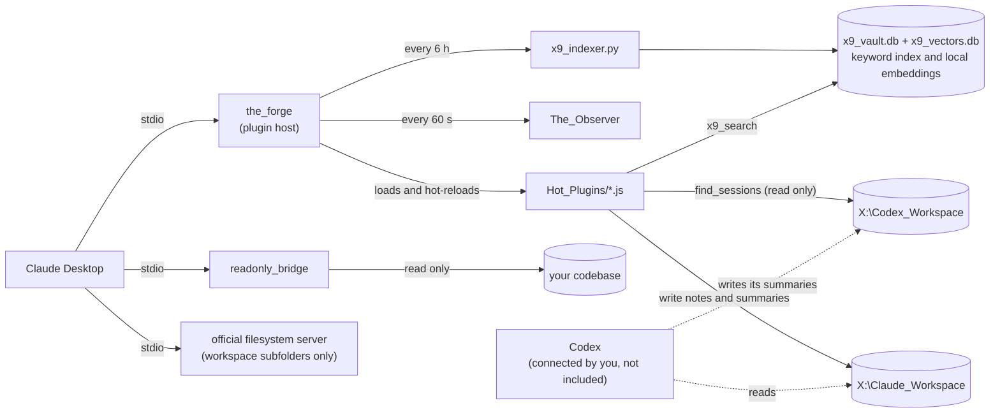

# Engineering notes

How this project came together: the problems I ran into, how I worked out what was wrong, what I chose and what it cost, and how I used AI agents to build and check it. The README covers setup; this page covers the reasoning.

## The problem

I wanted Claude Desktop on Windows to keep a working memory on an external SSD: notes, plans, decisions and past conversations that every new chat can reach, and that other tools (Codex, an editor) can read as plain files.

Constraints I set:

- **Plain files only.** No database server, no cloud service. If the tools disappear, the workspace is still just folders of markdown.
- **The model is not trusted with code execution.** Claude may read and write notes, but it must not be able to change the code that runs on my PC, and it must only ever read my real codebase.
- **No restarts to add a tool.** Restarting Claude Desktop loses the conversation, so new tools have to load while it runs.
- **Windows first**, with drive letters, `cmd.exe` quoting rules and file locking that a Linux-first tool would get wrong.

## Architecture

Three separate MCP servers, each with the smallest set of permissions it needs:

| Server | Can do | Cannot do |
|---|---|---|
| `the_forge` | Run the plugins in `Hot_Plugins`, write into workspace folders, log tool calls | Write into `_mcp_tools` or `Claude_Plugins` (unless you opt in) |
| `readonly_bridge` | Read one folder, run four fixed git commands | Write anything. It has no write tools at all. |
| filesystem server | Read and write the workspace subfolders it is given | Reach the folders that hold code, because they are not on its list |

## Design decisions and trade-offs

**Hot-reloading plugins.** The Forge watches `Hot_Plugins` and re-imports a plugin when it changes, then tells the client its tool list changed. Node caches ES modules by URL, so each reload imports `file.js?t=<timestamp>`. `fs.watch` fires several events for one save, so reloads are debounced by 1.5 seconds. The cost: every reload keeps the old module in memory until Claude Desktop restarts. That is written down in `SECURITY.md` as a known limitation rather than hidden.

**A separate process for the codebase, with no write tools.** I could have used the official filesystem server with a "read-only" instruction. Instead the bridge only defines read tools, so a confused or prompt-injected model has nothing to call that writes. The git tool takes an enum of four commands mapped to fixed argument arrays, so no model-supplied text reaches git.

**Keyword search first, semantic search as a local add-on.** Keyword search is SQLite FTS5 with the trigram tokenizer, run by Python's standard library: no model, no API key, works offline, and partial words match (`deploy` finds `deployment`). It matches letters, not meaning. Semantic search fills that gap, but it is optional, so the project still works with nothing but Python installed. See problem 6 for how it was built.

**Summaries, not transcripts, for sharing context.** Full transcripts are large, noisy, and full of things that should not be kept (pasted secrets, tool output). `save_session_summary` asks the model for a structured summary: what was asked, what was decided and why, exact file and branch names, what is unfinished. That is what the next session, or Codex, actually needs.

**Pull, never push, between agents.** Claude writes only to its workspace and reads Codex's. Codex should do the reverse. If neither writes into the other's folder, a mistake or a prompt injection on one side cannot change the other side's files. Claude's half of that rule is enforced by the config; Codex's half depends on how the user gives Codex access, so the README spells out the settings that keep it. Text from the other agent is labelled as data, not instructions, in the tool descriptions and the server instructions.

**Safe by default, opt in to risk.** Plugin writing is off unless `X9_ALLOW_PLUGIN_WRITE=1`. Secret-file blocking in the bridge is on unless turned off. Each of these was a choice between convenience and safety, and I kept the convenient option available behind a setting with the risk explained next to it.

## Problems I hit and how I solved them

### 1. The drive did not work at all

**Symptom.** In February 2026, Claude Desktop on Windows would not accept folders outside `C:`. My first workaround, the official filesystem MCP server, failed to start with `spawn npx ENOENT`.

**Diagnosis.** The server log showed Claude Desktop could not find `npx`. Node.js was installed only inside WSL, so Windows programs could not see it.

**Fix.** Installed Node.js for Windows and used full paths (`C:\Program Files\nodejs\npx.cmd`) in the config. Later I switched the custom servers to `node.exe` directly because starting through `npx` timed out. Both lessons are now in the README's troubleshooting section and the example config, so nobody else has to rediscover them.

### 2. Large multi-file reads broke the next request

**Symptom.** Reading several very large files in one call worked, but the next request failed with an API 500 error.

**Diagnosis.** The failure followed the size of the request, not the model's context window: one tool result was simply too big to send.

**Fix.** At the time, I split heavy reads from other work. The bridge now also caps a file at 512 KB and a multi-file read at 2 MB and 50 files, and refuses binary files, so one call cannot produce a response that size. The limits can be changed with environment variables.

### 3. Security review before going public

Before publishing, I had every source file, dependency lockfile and config reviewed for vulnerabilities, secrets and personal data. Four real problems came out of it:

| Problem | Why it mattered | Fix |
|---|---|---|
| `panoptic_push` joined a model-supplied file name to a folder without checking it | `..\..\Hot_Plugins\x.js` would write a plugin, and the Forge would then run it: a path from a prompt to code execution | One shared `resolveInside()` that rejects `..`, absolute paths, drive letters, alternate data streams and illegal characters. Tested with Windows path rules (`path.win32`) on every OS. |
| The search plugin built a `cmd.exe` command line from the query | Escaping `"` with `\` does not work in `cmd.exe`, so `x" & calc & "` would run a program | `execFile` with an argument array and no shell, plus a length limit and a timeout |
| The bridge checked containment with `startsWith` | `C:\app-secrets` passes as inside `C:\app`, and symlinks could point outside | Compare whole path segments with `path.relative()`, and check again after resolving the real path |
| 28 known dependency vulnerabilities, 1 critical | Inherited from older SDK versions | Updated within the same major versions after a supply-chain check (below); `npm audit` now reports 0 and CI enforces it |

### 4. A safety setting that could be bypassed

**Symptom.** None. This was found by reading two documents side by side.

**Diagnosis.** `panoptic_push` refused to write into `_mcp_tools` by default, but the example config gave the official filesystem server the whole workspace, which contains `_mcp_tools\Hot_Plugins`. That server has `write_file`, and the Forge runs any `.js` file that appears there. So the default protected one door and left another open. I reproduced it with the real filesystem server (version 2026.8.31, on Linux) before changing anything: with the workspace root, a write into `Hot_Plugins` succeeded.

**Fix.** The filesystem server has no deny list, so the example config now lists the workspace subfolders explicitly and leaves out `_mcp_tools` and `Claude_Plugins`. With that list the same write is refused. The trade-off (files at the workspace root are not reachable by that server) is documented in the README and `SECURITY.md`.

### 5. Search stopped being useful

**Symptom.** Search results were old, and searches often returned logs of earlier searches instead of documents. So the tool was rarely used.

**Diagnosis.** Two separate causes. The index was only ever built by hand, so it drifted weeks out of date. And the Forge's action log, which records every tool result, was itself being indexed, so each search added its own results to the next index: a feedback loop.

**Fix.** The Forge now rebuilds the index in the background (15 seconds after start if it is more than an hour old, then every 6 hours). The rebuild writes a temporary file and swaps it in, with retries because Windows refuses the swap while a search has the file open, so a search never sees a half-built index. The action log and raw chat copies are excluded, while the readable chat exports stay searchable. Every word now matches in any order, file names are searched, quoted phrases work, and results show a date and a highlighted snippet. The tool warns when the index is more than two days old.

### 6. Search by meaning, on a laptop, without sending files anywhere

**Problem.** Keyword search cannot answer "how much do we charge customers" when the note says "the starter plan costs 29 dollars". The obvious fix, a cloud embedding API, would send every file in the workspace (business plans, legal drafts, chat logs) to a third party.

**Constraints.** Everything runs locally. Search must keep working with nothing but Python installed. Any new dependency goes through the same supply-chain check as the npm updates.

**Decisions.**

- **Model.** BAAI/bge-small-en-v1.5 (MIT, 384 dimensions, 133 MB as ONNX), run with `onnxruntime` and `tokenizers`. The usual wrapper, `fastembed`, pulled in 30 packages; calling the two libraries directly took about 60 lines and 21 packages. The download is pinned to a 2024 commit and refused unless its SHA-256 matches. That mattered because Hugging Face reportedly had an intrusion in July 2026.
- **Storage.** A second SQLite file next to the keyword index, with one row per chunk of about 1,000 characters. The keyword index is rebuilt from scratch every time, but embeddings are slow, so they are keyed by a hash of the file's text and reused when it has not changed. Search is a plain matrix product over all 21,700 vectors in numpy: exact, no vector database, and it takes about a second, including loading the model.
- **Ranking.** Hybrid by default: the keyword and semantic result lists are merged with reciprocal rank fusion, which needs no tuning between two very different scoring scales. Exact names and error messages still come from keyword search; ideas come from semantic search. Each result says which search found it.

**What measuring changed.**

- **The first build did not fit.** At about 15 chunks a second, my workspace (1,028 files, 21,692 chunks) took 21 minutes, and the Forge kills a background run at 10. The build is now resumable. Each run embeds for at most 8 minutes, newest files first, then saves. A marker file makes the Forge continue a minute later, and again after a restart. Every run embeds at least one file, so it always makes progress. After the first build, a refresh reused all 21,692 chunks and the semantic step took 0.1 seconds.
- **The similarity cut-off from my small test was wrong.** On three short notes, related text scored 0.62 to 0.70 and unrelated text 0.52 or lower, so I picked 0.6. On the real workspace, off-topic queries ("recipe for banana bread", "zebra crossing safety in Paris") still scored 0.51 to 0.65, while real questions matched at 0.69 to 0.75. The default is now 0.65 and can be changed with a setting.
- **Memory.** onnxruntime's memory arena made embedding about 45% faster but peaked at 2.1 GB, against 1.1 GB without it. This runs in the background on other people's machines, so I turned the arena off.
- **Honest limits.** Given a copied 12-word passage, semantic search put the original file in its top 5 for 44 of 60 passages. Finding exact text is what keyword search is for, which is why hybrid mode keeps both.

**Testing without a model.** CI cannot download 133 MB on every run, so the tests use a stand-in embedder (a hashed bag of words). It exercises chunking, storage, reuse, the time budget, the hybrid merge and every fallback, with only numpy installed. One more test runs the real model when it is installed and checks that paraphrased questions with no shared words find the right note.

## How I work with AI tools

AI tools (Claude and Codex, and Gemini during the early troubleshooting) are part of my workflow, and this project is itself infrastructure for working with them. What makes that work:

- **Evidence before claims.** I asked for reports that separate what was tested from what was only read in the code. The security report marks the `cmd.exe` injection as "established by reading the code; not executed on Windows", and each pull request lists what was not checked. That kept me from believing claims nobody had verified.
- **A second, independent reviewer.** Pull request #4 was reviewed by a separate agent that had not written the code. It found three real bugs the first pass had missed: a Codex folder-name mismatch, readable chat logs being dropped from search, and a missing check in the live migration script. All three were fixed in the same pull request.
- **Decisions stay with me.** Reviews ended with a list of decisions instead of making them silently. Turning plugin writing off by default, turning secret blocking on, limiting the Observer to the chat log file, removing an unused `puppeteer` dependency and keeping private and business details out of the repo were my calls.
- **Supply-chain checks before installing anything.** Dependency updates went through a six-layer check: lockfile diff, dependency tree, advisories cross-checked against OSV, maintainer and provenance changes, registry integrity hashes and signatures, and a search for active npm attack campaigns. Versions published in the previous day were held back. CI now repeats the audit and signature check on every pull request.
- **Tests as the contract.** 133 tests cover the path rules (including Windows rules, simulated on any OS), every plugin, the bridge, the log filter, and keyword and semantic search. CI runs them on Windows and Ubuntu with Node 22 and 24. A change is not done until they pass.
- **Reversible changes to the live setup.** Every update to my running install made a backup first and came with written rollback steps.
- **Not trusting the AI's explanations.** Some early explanations, such as the exact cause of the original Claude Desktop bug, came from a model reading logs. Where I could not check them, I do not state them as fact.

## What I would do next

- Capture Codex and Claude Code sessions in the Observer, with a text-only mode that drops tool output and injected context. The Codex log format is already mapped; Claude Code's log location still needs to be confirmed.
- Run the full setup end to end on a clean Windows machine, not only the test suite.
- Support web clients properly. ChatGPT, Codex in ChatGPT and the claude.ai website can only reach an MCP server at a public HTTPS address. In my own setup I used ngrok tunnels for that, but these servers have no authentication, so a tunnel gives anyone with the URL the same access the tool has. That is why tunnels are not part of the project. A supported remote mode needs authentication built into the server, read-only tools by default, and no exposure of the Forge or a write-capable file server.
